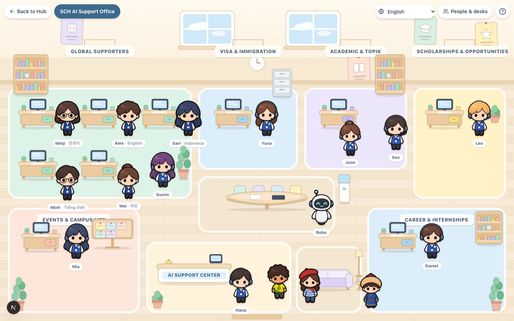

# SCH AI Support Office (`/ai-office`) — Phase 1

A full-screen, illustrated 2D office where every staff member opens a real Hub function: the existing grounded assistant (RAG chat with citations), Knowledge Center guides, published announcements and events, or the existing Global Supporter handoff.

It is frontend only:
- no new backend, database, embeddings or model integration;
- no changes to student records or content.

## Who is in the office

The art comes from `assets/characters/`: transparent, single-figure PNGs with a uniform 20 px margin. They are copied unchanged by `apps/web/scripts/sync-office-characters.mjs`, and shown at one height with their own aspect ratio, never cropped or mirrored.

| Character (file) | Role | Real function |
|---|---|---|
| Hana (`Agent_General_AI.png`) | Reception | Chat (site language); desk directory |
| Robo (`AI_General_Robot.png`) | Office guide | How the office works; desk directory |
| Minji (`Staff_04_Glasses_Female.png`) | Korean supporter | Chat that answers in Korean |
| Alex (`Staff_07_Curly_Hair.png`) | English supporter | Chat that answers in English |
| Sari (`Staff_09_Long_Blue_Hair.png`) | Indonesian supporter | Chat that answers in Indonesian |
| Minh (`Staff_03_Glasses_Male.png`) | Vietnamese supporter | Chat that answers in Vietnamese |
| Mei (`Staff_06_Ponytail.png`) | Chinese supporter | Chat that answers in Chinese |
| Sumin (`Agent_Global_Supporter.png`) | Global Supporter team | Human support: existing consented handoff (signed in) or the Student Support page |
| Yuna (`Agent_Visa_and_Stay.png`) | Visa & immigration | Chat; approved `visa-immigration` guides |
| Joon (`Agent_Academics.png`) | Academic | Chat; `academic-life` guides; latest university notices |
| Seo (`Agent_TOPIK.png`) | TOPIK & Korean | Chat; `topik-korean` guides |
| Leo (`Agent_Events_and_Contests.png`) | Scholarships & opportunities | Published `scholarships` announcements and guides (says so honestly when there are none); chat |
| Mia (`Agent_Life_in_Korea.png`) | Events & campus life | Published current and upcoming announcements with dates, soonest first; chat |
| Daniel (`Agent_Part_Time_Job.png`) | Career & internships | Chat; `employment-internships` and `part-time-employment` guides |
| 3 visiting students (`BR_Brazil`, `MN_Mongolia`, `FR_France`) | Scenery | Not interactive |

- **Language supporters use the neutral staff artwork**, so they represent language services, not nationalities.
- **Unused assets:** the remaining 25 assets are available for later roles.

## Architecture

| Piece | File (`apps/web/src/...`) |
|---|---|
| Route (hides site header/footer and the floating chat) | `app/ai-office/page.tsx`, `components/layout/fullscreen-route.tsx` |
| Page shell: floating header, help, people menu, panel state, deep link `?desk=<id>` | `features/ai-office/ai-office.tsx` |
| Scene: 1600 × 1000 stage scaled to the viewport, depth-sorted furniture and characters, zone signs | `features/ai-office/office-scene.tsx`, `backdrop.tsx`, `furniture.tsx` |
| Configuration: zones, furniture footprints, characters, desks, routes | `features/ai-office/characters.ts` |
| Movement: one shared requestAnimationFrame loop | `features/ai-office/movement.ts` |
| Agents: capabilities (available or planned), `AgentTask` contract | `features/ai-office/agents.ts` |
| Dialogue panel: tabs come from the available capabilities | `features/ai-office/office-panel.tsx` |
| Desk data (existing public APIs) | `features/ai-office/desk-resources.tsx` |
| Supporter lines (in each supporter's own language) | `features/ai-office/supporter-lines.ts` |
| Shared chat (also used by the floating widget) | `features/chatbot/use-assistant-chat.ts`, `features/chatbot/chat-body.tsx` |

### Movement

- **One shared loop:** positions are written straight to the DOM, so there is no React re-render per frame.
- **Routes:** fixed back-and-forth waypoint paths with seeded random idle times. Every segment is tested to stay clear of every furniture footprint.
- **Crowding:** walkers wait briefly instead of walking into someone.
- **Clicking:** a clicked character stops until its conversation closes.
- **Pausing:** the loop stops while the tab is hidden, never starts with reduced motion, and switches walking off when frames are slow. `destroy()` removes everything.

### Chat

- **Same as the floating widget:** the same hook and view, with streaming, history, citations, follow-ups and handoff.
- **Language:** supporters pass their own language, and the backend answers in it unless the student explicitly asks for another. Desk staff use the site language.
- **Separate conversations:** each character has its own (anonymous: session storage; signed in: a stored conversation, as before).
- **Desk prompts are visible:** desk "context" is only visible suggestion chips that the student sends themselves. No hidden instructions are added.

### Layout

- **Wide screens:** the whole office is visible. With a conversation open on desktop, the office re-fits beside the panel, so every character stays clickable.
- **Narrow screens:** the office keeps a readable scale and scrolls sideways, starting at reception. A "People & desks" menu is the alternative to tapping figures, and conversations open full screen.

## Tests

| Check | Result |
|---|---|
| Unit and UI (vitest) | 181 passed in 31 files |
| Lint, typecheck, production build | clean |
| Real Chrome, against a local seeded backend from this branch | 31 checks passed |

The unit and UI tests cover:
- scene geometry, asset sizes and routes clear of furniture;
- the movement manager: hold and release, reduced motion, hidden tab, a single loop, cleanup, slow devices;
- the office UI: supporter languages through the real endpoint, follow-ups, citations, desk data, events order, the empty opportunities state, keyboard, menu, directory, listener cleanup, language switch;
- that the existing chat widget is unaffected.

The browser checks covered desktop at 1440 × 900, phone at 390 × 844 with touch, and reduced motion:
- images load and characters stay in the scene and walk;
- hover tooltip, clicking, held characters, the streaming endpoint, citations opening documents, follow-ups;
- the events and announcement pages, the visa guides, the honest empty state;
- keyboard, help, language switching without a reload, Back to Hub, the floating chat still working elsewhere;
- no page or hydration errors;
- on the phone: no page overflow, characters about 105 px tall, sideways exploration, a full-screen chat.

## Limitations (Phase 1)

- **Retrieval isn't scoped per desk.** The desks use the general RAG flow; the backend has no per-category chat retrieval yet.
- **Static artwork.** The PNGs have no sprite frames, so idle and walking are a gentle bob or waddle. There is no blinking, and characters don't turn to face their direction.
- **No live discovery.** No live scholarship, competition, job or event search: those capabilities are shown as "coming later" and never run.
- **No sound.**
- **Images are served at their original size.** About 1.5 MB in total, loaded only on `/ai-office`.

## Phase 2 plan (advanced agents)

1. **Backend scoping.** An optional, validated `topic` on the chat endpoints that limits retrieval to a category allow-list (server-side, so the client cannot widen it). Desks pass their topic.
2. **Agent tasks.** A `agent_tasks` table and API following `AgentTask`: status, sources, result and confirmation. Run on the existing durable job queue and the external scheduler (`run-due`).
3. **Read-only agents first:**
   - an announcement watcher (new or updated notices → summaries in 5 languages, from published content only);
   - a deadline tracker (deadlines from published announcements → reminders the student subscribes to);
   - an opportunity collector (scholarships and competitions from an admin-approved list of official sites, through the existing guarded fetcher and the normal review workflow; nothing is shown before approval).
4. **Write actions need confirmation.** Drafting multilingual notices, sending reminders and submitting forms stop at `needs_confirmation` until an authorized person approves; they are audited and use the existing permissions.
5. **Office integration.** Characters show task badges ("3 new scholarships to review"). Capabilities switch from "coming later" to "available" only when their tool is live.
