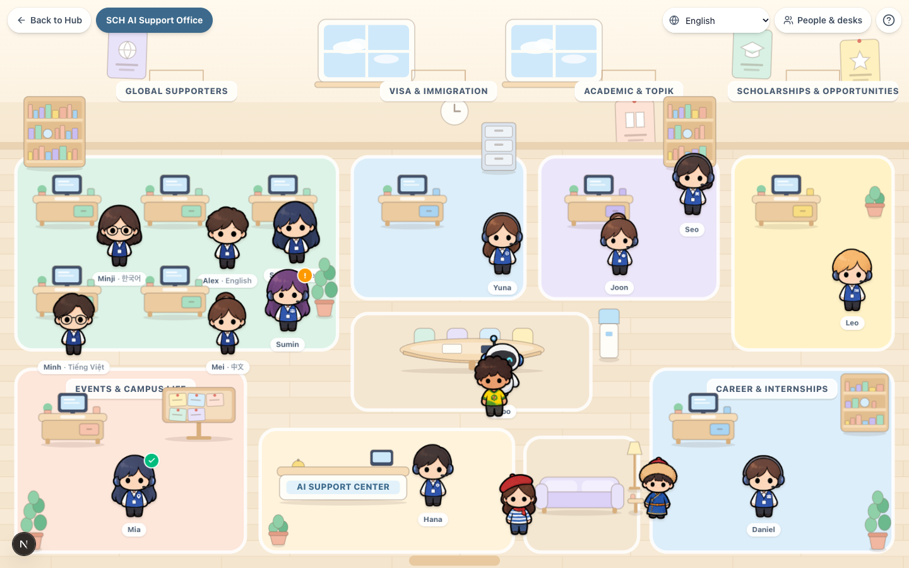

# AI Support Office — Phase 2: agents, tools and tasks

Phase 2 connects every office character to a backend **agent**: an identity with a job description, a fixed set of permitted tools, and durable tasks that the student can follow step by step.

- All agents share one model provider and the existing retrieval services.
- Most tools are deterministic lookups over approved, published Hub content and make no model call.
- The office artwork, characters and Phase 1 features are unchanged. Each character gains a **Tasks** tab and a status icon.



## How a request flows

```
student ── Tasks tab ──► POST /agents/{id}/requests
                             │
                  router.py (keyword rules, 5 languages, no model)
        ┌──────────┬─────────┼──────────────┬───────────────┐
      answer     tool       task          approval        clarify
   (chat tab:  (instant,  (agent_tasks   (agent_tasks       (options)
    grounded   read-only)  row, worker)   awaiting_approval)
    RAG chat)
```

- **Permissions.** Every tool call goes through `ToolRegistry.run`, which checks the agent's allowlist, availability, sign-in, background-only and approval rules.
- **Delegation.** Reception and the language supporters hand specialist work to the right agent. Other agents point the student to the right desk.

## Files

| Piece | File |
|---|---|
| Agent registry (identity, scope, allowed tools, task types, delegation, restricted actions, quick actions) | `backend/app/services/agents/registry.py` |
| Tool registry and permission checks; the 20 tools | `backend/app/services/agents/tools.py` |
| Request router | `backend/app/services/agents/router.py` |
| Tasks: create, claim, execute, retry, cancel, approve, delegate, schedules, retention | `backend/app/services/agents/tasks.py` |
| What each task type does | `backend/app/services/agents/handlers.py` |
| API | `backend/app/api/agents.py` |
| Database (additive) | `supabase/migrations/20261124000014_agent_tasks.sql`, rollback in `supabase/rollback/` |
| Frontend: API client and directory polling | `apps/web/src/features/ai-office/agent-api.ts` |
| Frontend: Tasks tab, status icon | `apps/web/src/features/ai-office/agent-work.tsx` |

## Agents

| Character | Agent id | Main tools | Background tasks |
|---|---|---|---|
| Hana | `reception` | delegates; announcements, RAG | `delegated_search` |
| Minji, Alex, Sari, Minh, Mei | `supporter-ko/en/id/vi/zh` (fixed language) | RAG, announcements, AI summary/translation; delegates | `summarize_announcement`, `explain_document`, `delegated_search` |
| Yuna | `immigration` | `visa_checklist`, deadlines, source check | `visa_checklist` |
| Joon | `academic` | `academic_checklist`, academic notices | `academic_checklist` |
| Seo | `topik` | `topik_dates` | `topik_dates` |
| Leo | `scholarship` | `scholarship_search`, deadlines, source check, official page (allowlisted) | `scholarship_scan` |
| Mia | `events` | `event_search`, deadlines | `event_digest` (what's new since last time) |
| Daniel | `career` | `career_opportunity_search`, official page (allowlisted) | `career_scan` |
| Robo | `announcement` | announcements, deadlines, AI summary | `announcement_digest`, `summarize_announcement` |
| Sumin | `support-coordinator` | `create_support_request` (after approval), `get_support_request_status` | `support_request` |

Every agent can also run its own read-only tools as a `lookup` task; that is how delegation works.

## Tools

All tools are real and call existing services.

- **Deterministic (no model):**
  - `rag_search`, `knowledge_document_lookup`, `announcement_search`, `announcement_detail`;
  - `deadline_extraction`: pattern-based; quotes the source line; dates entered by reviewers come first; a date without a year is flagged;
  - `scholarship_search`, `career_opportunity_search`: category plus keywords in 5 languages; duplicates removed; expired items hidden or labelled;
  - `event_search`: upcoming, soonest first;
  - `visa_checklist`, `academic_checklist`: quoted passages from approved guides;
  - `topik_dates`;
  - `source_verification`: Hub-approved, allowlisted official domain, or unknown;
  - `get_support_request_status`: the caller's own tickets only;
  - `create_agent_task` / `get_agent_task_status`.
- **Network, background only:** `official_page_fetch`. It uses the existing `GuardedFetcher` (domain allowlist, SSRF checks on every redirect, robots.txt, size and time limits). Results are labelled "official site, not reviewed" and are never used in answers.
- **Model, background only, signed in, counted against the daily AI budget:** `summarize_document`, `translate_text`. They use the shared translation model slot and are labelled "AI, not reviewed".
- **Writes, only after the student approves that exact task:** `create_support_request`, through the existing `SupportService.create_ticket`. The approval is the consent.
- **Unavailable, and says so:** `official_web_search`. No search provider is configured; the UI lists it as "not available" and calling it returns `409 tool_unavailable`.

### Reliability labels

| Label | Meaning |
|---|---|
| `verified` | Approved, published Hub content within its review interval |
| `possibly_outdated` | Approved, but older than its category's review interval |
| `expired` | Its deadline has passed |
| `external_unverified` | Fetched from an allowlisted official site, not reviewed by staff |
| `ai_generated` | Written by the model from the linked source, not reviewed |

Notes such as "only the scholarship office decides eligibility" are returned as codes and shown in the student's language.

## Tasks

- **Statuses:** `queued → running → completed | failed | cancelled`. Actions with side effects start in `awaiting_approval`.
- **Where they run:** the existing worker thread (`JobRunner`). It claims ingestion jobs first, then agent tasks, through `claim_agent_task` (`FOR UPDATE SKIP LOCKED`). Tasks never run inside the HTTP request that created them; in inline mode (tests) they run as a background task after the response.
- **Recovery:** tasks of a dead worker (no heartbeat) are re-queued, or failed once `max_attempts` (3) is reached.
- **Retries:** transient failures (model or network) re-queue after 30 s, 60 s, ...; permanent failures fail with a code.
- **Cancellation:** queued and awaiting tasks cancel immediately; a running task stops at its next step.
- **Timeout:** 180 s, checked between steps.
- **Idempotency:** one active task per (owner, `idempotency_key`), enforced by a unique partial index.
- **Quotas:** 5 active and 30 tasks per day per student; instant tools are limited to 30 per minute per user or IP.
- **Provenance:** `agent_task_events` records every step with the agent that performed it (queued, start, tool, delegate, result, error, cancel, approval). The result records `generated_by` (`deterministic` or the model id) and the cited links.
- **Delegation:** only to agents in `can_delegate_to`, at most two levels deep, never back to an agent already in the chain. The child task runs inside the parent's worker run, and both are shown.
- **Change detection:** digests compare with what this student (or the schedule) saw last time and mark items `new` or `updated`.
- **Retention:** finished tasks and their steps are deleted after 30 days, by `run-due` / `purge-expired`.

## Scheduled agents: present but off

Four schedules are seeded, **all disabled**: announcement digest (12 h), scholarship scan (24 h), event digest (12 h), career scan (24 h). A schedule runs only when both of these are true:

1. the server switch `AGENT_SCHEDULES_ENABLED=true` (default `false`);
2. an admin enabled that schedule: `PATCH /api/v1/admin/agent-schedules/{id}` (audited).

The existing scheduler hook (`/internal/sync/run-due` or `python -m app.cli run-due`) then queues due schedules as system tasks. Official pages for a schedule can only be set by an admin, must be on the domain allowlist, and are limited to 5.

## API

| Method and path | Who | What |
|---|---|---|
| `GET /api/v1/agents` | anyone | Directory: agents, tools with availability, actions, restricted actions, the viewer's state per agent |
| `POST /api/v1/agents/{id}/requests` | anyone; tasks need sign-in | Free-text request → answer / tool / task / approval / clarify / redirect |
| `POST /api/v1/agents/{id}/tools` | anyone (sign-in for private tools) | Run one instant read-only tool |
| `POST /api/v1/agents/{id}/tasks` | signed in | Start a task |
| `GET /api/v1/agent-tasks`, `GET /api/v1/agent-tasks/{id}` | owner | List; detail with steps and child tasks |
| `POST /api/v1/agent-tasks/{id}/cancel` | owner | Cancel |
| `POST /api/v1/agent-tasks/{id}/decision` | owner | Approve or decline (`{"approve": true}`) |
| `GET`/`PATCH /api/v1/admin/agent-schedules[/{id}]` | admin | Schedules (enable, interval, official pages) |

## Database (migration 0014, additive)

| Table or function | Holds |
|---|---|
| `agent_tasks` | Owner, agent, type, validated params (≤ 20 kB), status, stage, result, citations, error, attempts, heartbeat, parent / depth (≤ 2), schedule |
| `agent_task_events` | The step log |
| `agent_schedules` | Disabled by default; interval 60 min to 7 days; change-detection state |
| `claim_agent_task(worker, stale_seconds)` | `security definer`; executable by `service_role` only |

- **RLS:** students can read only their own tasks and steps. Students cannot insert, update or claim; they cannot read schedules; anonymous users cannot read anything.
- **Not stored:** conversation transcripts. Task params hold only the request, and results hold titles, links and extracted facts.
- **Tested** on a scratch PostgreSQL 18 with pgvector (`supabase/tests/behavior_test_agent_tasks.sql`):
  - constraints and idempotency;
  - claim, stale recovery and the retry limit;
  - RLS for students and anonymous users;
  - cascade on delete;
  - re-running the migration changes nothing;
  - rollback followed by re-apply.

## Security review

| Risk | Control |
|---|---|
| A prompt makes an agent do something it should not | Routing is keyword rules, not a model. Tools are fixed functions with typed parameters (unknown fields rejected). No model output is ever executed as code, SQL or a URL. |
| The frontend grants itself a tool | Allowlists live in `registry.py` and are checked in `ToolRegistry.run` on every call. The frontend only displays them. |
| Reading another student's data | Tasks, steps and tickets are filtered by the verified token's user id. Another user's task returns 404; RLS repeats this in the database. |
| Unwanted side effects | The only write is a support request, and it runs only after the owner approves that stored request. Nothing is published, changed or sent automatically. Agents never decide eligibility, visas or work permission (listed per agent). |
| SSRF or unapproved sites | Only the existing `GuardedFetcher` (allowlist, DNS and SSRF checks on every hop, robots.txt, limits). Students cannot pass URLs to a fetch; schedule pages are set by admins and allowlisted. |
| Cost or abuse | Rate limits, task quotas, the daily AI budget for model tasks, a timeout, bounded work per task (10 detail lookups, 5 pages). Scheduled jobs are off. |
| Unbounded data | Params are size-checked; the step log is ≤ 2000 characters per message; retention is 30 days. |
| Misleading results | Every item carries a reliability label and a link to its source. Model text is labelled AI. Empty results say so. Unavailable tools say why. |

## Cost and latency

- **Most requests cost nothing in model usage:**
  - routing and every lookup are database or keyword work;
  - an instant lookup takes about 10–100 ms locally, plus query embedding for `rag_search` (local ONNX model);
  - a digest or scan task finishes in about 0.1–1 s plus worker pickup (poll interval up to 10 s; inline mode starts immediately).
- **Model calls** happen only for `summarize_announcement` / `explain_document` (2 requests: title and summary) and `translate_text` (1 request). They use the shared provider and count against the student's daily AI budget. Free-text questions routed to "answer" use the existing chat and its existing limits.
- **Polling:** the office polls `GET /agents` every 30 s, or every 3 s while one of the viewer's agents is working, and pauses while the tab is hidden. The Tasks tab polls one list every 2.5 s only while a task is queued or running.

## Tests

| Suite | Result |
|---|---|
| Backend unit (`tests/test_agents.py`, 46 tests): registry mappings, tool permissions, real tools on seeded data, empty results, router in 5 languages, delegation and redirect, task lifecycle and provenance, change detection, approval, cancel, worker claim and recovery, retries, idempotency, quotas, privacy, delegation depth and loops, AI tasks labelled or refused, schedules off by default, allowlisted schedule pages, retention | 46 passed; whole backend 564 passed, 15 skipped |
| Real database through PostgREST (`tests/integration/test_agents_integration.py`) | 4 passed; all integration tests 12 passed |
| SQL behaviour (`behavior_test_agent_tasks.sql`) plus the 9 existing suites | all passed; rollback and re-apply verified |
| Web (`agent-work.test.tsx`, 7 tests): state icons, quick tool, reliability and notes, honest tool list, redirect, question to chat, approval flow, translated errors, service down | 205 passed in total; lint, typecheck and build clean |
| Real Chrome against a seeded local backend: desktop 1440, tablet 820 (touch), phone 390 (touch), Korean UI, reduced motion | 42/42 checks passed |

The browser checks covered:
- quick tools with results that open the announcement;
- reception delegating to Mia;
- redirect to the right desk;
- visa checklist quotes;
- questions going to the chat;
- a signed-in background digest with steps;
- the office showing Finished and Waiting icons;
- the approval card, with the ticket created only after approval;
- TOPIK dates in Korean;
- no page overflow and the panel fitting on tablet and phone;
- no page errors.

Signed-in browser checks used a local test token against the in-memory backend; no real accounts were used.

## Limitations

- **No open-web search.** Discovery is limited to what staff have published, plus allowlisted official pages that an admin sets on a schedule. Competitions, programs and external scholarships appear only once staff publish them.
- **Routing is keyword-based.** Unusual phrasings fall back to the chat answer, or to "clarify" for very short messages. That fallback is safe, but less clever than model routing.
- **Dates are pattern-based.** Ranges written in unusual formats can be missed. Reviewer-entered dates are preferred, and every extracted date carries its quote.
- **Change detection** compares the latest list with the previous run. It does not track edits to an announcement body that change neither its title nor its dates.
- **Deadline reminders, notice drafting, competition and program discovery** are still "coming later".
- **AI summaries need a configured model.** Without one, the tools are listed as unavailable.
- **Limits are per process.** Like the existing chat limits, instant-tool rate limits live in memory (single Render instance). Task quotas are stored in the database.

## Deployment requirements (not done; needs approval)

1. Apply migration `20261124000014_agent_tasks.sql` to production after a backup. It is additive and creates three tables and one function; the four schedules are inserted disabled.
2. Deploy the backend and frontend from this branch.
3. Keep `AGENT_SCHEDULES_ENABLED` unset (`false`). Optional settings, with their defaults:

   | Setting | Default |
   |---|---|
   | `AGENT_TASKS_ENABLED` | `true` |
   | `AGENT_MAX_ACTIVE_TASKS_PER_USER` | 5 |
   | `AGENT_DAILY_TASKS_PER_USER` | 30 |
   | `AGENT_TOOL_RUNS_PER_MINUTE` | 30 |
   | `AGENT_TASK_TIMEOUT_SECONDS` | 180 |
   | `AGENT_TASK_RETENTION_DAYS` | 30 |

4. Smoke test: `GET /api/v1/agents` (expect 15 agents, web search unavailable); a quick tool; for a signed-in test account, an event digest task and a declined support request.

## Rollback

| To undo | Do this |
|---|---|
| Code | Redeploy the previous commit. The office works without the agent endpoints: the Tasks tab says the agents can't be reached, and chat and desk tabs keep working. |
| Background tasks only | Set `AGENT_TASKS_ENABLED=false`. |
| Database | Run `supabase/rollback/20261124000014_agent_tasks_down.sql`. It drops only the 0014 objects, and task history is lost, so take a backup first. |
