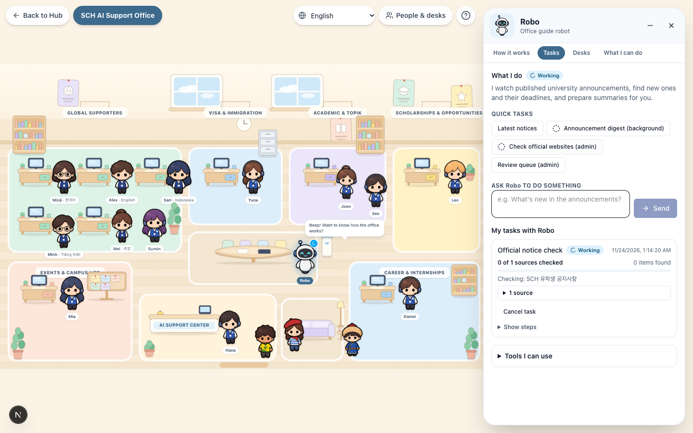
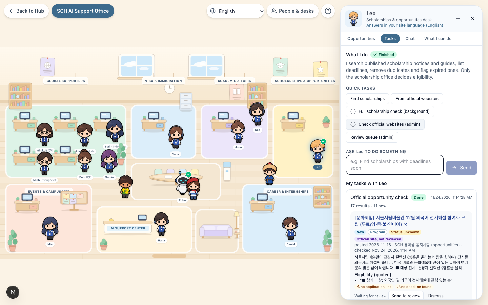
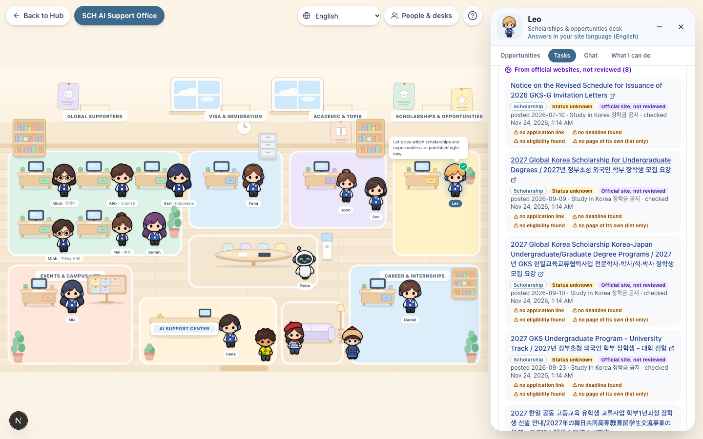

# AI Support Office — Phase 3: official-source discovery

Robo (announcements) and Leo (scholarships and opportunities) can now check configured official websites. They report new and changed notices with their dates, deadlines, eligibility and application links. They never decide what is true or publish anything:

- every discovered item is a **review candidate**;
- students see official-site results labelled **"From official websites, not reviewed"**;
- an opportunity is **"open" only when the source says so**.

## What already existed (audit) and what was reused

| Existing piece | Phase 3 use |
|---|---|
| `GuardedFetcher`: domain allowlist (environment plus admin-managed domains), SSRF checks on every redirect, robots.txt, 5 MB and 20 s limits, GET only | Every discovery request goes through it. Added: robots.txt is re-read after 6 hours instead of being cached for the life of the process. |
| SCH board parser (`sch_board.py`: list → notices) | Reused unchanged as the `sch_board` connector. |
| HTML / PDF extractors (PDF in an isolated process with a timeout) | Reused for item pages and PDFs. |
| Knowledge sources, ingestion jobs, review screen | "Send to review" creates a normal source and job. The item becomes a pending-review version: the only path to approved content. |
| Phase 2 agents, tools, tasks, worker, disabled schedules | Two new task types and three tools. The worker, progress, schedules and permission checks are shared. |
| Admin notifications, audit log | Notifications for new candidates (scheduled runs); audits for source changes and review actions. |

In production (read-only check on 2026-11-24) only five Study in Korea **website** knowledge sources exist. No SCH board source is configured, so announcement monitoring was not running.

## Connectors (`backend/app/services/discovery/connectors.py`)

| Kind | For | How |
|---|---|---|
| `sch_board` | SCH notice boards (`notice01.php`) | The existing parser: list page, then each notice (title, KST posting date, body, attachments, links). |
| `listing` | Any official list page | An admin gives CSS selectors (item, optional title / date / link) and an optional URL pattern. Items with a link on the same host are followed (HTML or PDF). Items that open through JavaScript (e.g. Study in Korea's `noticeRead(...)`) keep the list page as their citation and are flagged `no_detail_page`. |
| `page` | One official page watched as a whole | Change detection plus facts. Text of message-only buttons (e.g. "접수 기간이 아닙니다", "not in the application period") counts as part of the page. |

All connectors follow the same rules:
- they never run page scripts, submit forms or follow links to other hosts;
- page content is plain text and its links are kept only if they are http(s);
- 1 s between requests to a site, at most 30 items per source, at most 10 sources per task;
- a manual re-check within 10 minutes reuses the last results without contacting the site;
- a page-structure change fails loudly (`board_structure_changed` / `listing_structure_changed`), never silently returning nothing.

## Facts extracted (`extract.py`, deterministic, no model)

- **Dates and deadlines** are quoted from the text. Period ends count as deadlines, and "(~11/6)" in a title is read as a deadline with the year flagged as assumed.
- **Eligibility** lines are quoted (자격, 대상, eligibility, ... in 5 languages).
- **Application links** are the page's own anchors whose text or URL means "apply", plus attachments such as 신청서.
- **Category and opportunity kind** (scholarship, competition, program, job) come from keywords. The title wins over the body, and the matched word is returned so reviewers see why.
- **Open status** is one of three values, and is never inferred from anything else:

  | Status | When |
  |---|---|
  | `closed` | The source says so, or every deadline has passed |
  | `open` | The source gives a future deadline, or says applications are open |
  | `unknown` | Anything else |

- **Flags** mark what is missing or uncertain, and the UI shows each one:

  | Missing | Uncertain or wrong | Other |
  |---|---|---|
  | `missing_deadline` | `year_assumed` | `no_detail_page` |
  | `missing_eligibility` | `open_status_uncertain` | `little_text` |
  | `missing_application_link` | `deadline_before_published` | `detail_failed` |
  | `missing_published_date` | `published_in_future` | |
  | | `several_deadlines` | |

- **Change detection:** a content hash of title, date and text gives `new`, `updated` or `unchanged`. A changed notice that was dismissed becomes a candidate again.
- **Deduplication:**
  - one item per canonical URL (scheme and host lower-cased, fragment and tracking parameters removed), enforced by a unique index;
  - the same notice under another URL (same title without the "[홍보]"-style prefixes, and same date) is linked with `duplicate_of` and hidden from students.

## Agents, tools, tasks

| | Who | What |
|---|---|---|
| `official_source_check` tool (background) | admins, or an admin-enabled schedule | Checks the agent's sources. Writes live progress (sources done, current source, items found, per-source status) to `agent_tasks.progress`. |
| `announcement_discovery` task (Robo) | admins / schedule | New and changed SCH notices as review candidates. Admins are notified on scheduled runs. |
| `opportunity_discovery` task (Leo) | admins / schedule | Scholarships, competitions and programs from the configured sources. |
| `opportunity_search` tool (instant) | everyone | Opportunities found on official sites, excluding dismissed items, duplicates and (unless asked) closed ones. Labelled unverified. Daniel uses it for jobs. |
| `review_candidates` tool | admins | The review queue of an agent. |
| `scholarship_scan` task (Leo, Phase 2) | signed-in students | Verified Hub results first, then official-site results, plus each source's last check. It reads what monitoring found and **never crawls on a student's behalf**. |

Admin API:

| Method and path | What |
|---|---|
| `GET`/`POST`/`PATCH`/`DELETE /api/v1/admin/discovery/sources[/{id}]` | Allowlisted URL, validated connector settings, enable/disable, reset failures (audited) |
| `GET /api/v1/admin/discovery/items` | List items |
| `POST .../items/{id}/dismiss` | Dismiss a candidate |
| `POST .../items/{id}/send-to-review` | Creates a pending-review version through the normal pipeline. Items without their own page must be added manually. |

## Office UI

The Tasks tab shows, all from the task record (polled every 2.5 s while it runs):

- **while a check runs:** a progress bar ("2 of 3 sources checked"), the source being checked, a per-source status (waiting / checking / ok / failed / blocked by the site / recently checked) and items found;
- **results**, in two sections:
  - **Verified in the Hub**;
  - **From official websites, not reviewed**;
- **for each discovered item:** kind, open status ("Open until 2026-12-10" / Closed / Status unknown), posting date, quoted eligibility, application links (opening the official site), flags, source name and last-checked time;
- **for admins only:** "Check official websites", "Review queue", and **Send to review** / **Dismiss** on each candidate. The backend checks the role again.

All new text is in all 5 languages.

| Admin view: Leo's candidates (live sources) | Student view: verified and unverified |
|---|---|
|  |  |

## Scheduling (disabled)

Migration 0015 adds two schedules, both **disabled**: `announcement_discovery` (12 h) and `opportunity_discovery` (24 h). Admins configure them with `PATCH /api/v1/admin/agent-schedules/{id}`:

| Setting | Allowed values |
|---|---|
| `enabled` | true or false |
| `interval_minutes` | 60 – 10080 |
| `params.source_ids` | up to 10 of that agent's sources |
| `params.max_items_per_source` | 1 – 30 |
| `params.max_sources` | 1 – 10 |
| `params.notify_admins` | true or false |
| `params.summarize_new` | optional AI summary of long new items, at most 3 per run, labelled AI |
| `params.review` | can only be `"admin"`. Publishing without review is refused. |

A schedule runs only if `AGENT_SCHEDULES_ENABLED=true` and that schedule is enabled. Sources that failed 5 times in a row are skipped by schedules until an admin resets them.

## Example results from the real sites (2026-11-24, local run, nothing stored)

| Source | Item | Result |
|---|---|---|
| SCH 유학생 공지사항 (`sch_board`) | [생활관] 2026-2학기 생활관 퇴사 안내 (posted 2026-11-23) | dormitory-housing; deadline **2026-12-11** quoted from the body; eligibility "대상: 학성사, 글로벌빌리지에 거주하는 모든 학부생 및 교환 학생" |
| | [생활관] 2026 동계방학 생활관 입사생 모집 안내 | deadline 2026-12-01; not classified as an opportunity |
| | [모집] 제13기 SCH 글로벌 서포터즈 모집 (~11/6) | program; **closed** (deadline passed), "year not stated" flagged |
| | [공모전] 제6회 NSU 성암·화정 국제 한국어 말하기 대회 참가자 모집 | competition; closed; "deadline before posting date" flagged; 1 application link |
| | [문화체험] 서울시립미술관 12월 외국어 전시해설 참여자 모집 | program; status unknown (no deadline in the text); eligibility quoted |
| Study in Korea 장학금 공지 (`listing`) | 2027 GKS Undergraduate Program – University Track (posted 2026-09-23), and 5 more | scholarship; **status unknown**; "no page of its own (list only)", because items open through a script; cites the list page |
| Study in Korea GKS page (`page`) | GKS 장학금 | **closed**, because the page's apply button says "접수 기간이 아닙니다"; 5 eligibility lines quoted (e.g. "국적: 지원자와 부모 모두 대한민국 국적이 아닌 자") |

A re-check found 0 new and 0 changed items. A manual re-check within 10 minutes made no request to the site.

## Security review

| Risk | Control |
|---|---|
| SSRF, arbitrary sites | Source URLs must be on the allowlist and pass the URL syntax rules (no IPs, localhost, credentials or non-http schemes). Every fetch re-validates DNS and redirects in `GuardedFetcher`. Item links are followed only on the source's own host. Students cannot supply URLs. |
| Site access restrictions | robots.txt is honoured (and re-read every 6 h). 401, 403, 406, 429 and robots blocks mark the source `blocked` and stop it; there is no retry loop against a refusing site. JavaScript-only pages are not scripted around. |
| Load on official sites | 1 s between requests, item and source caps, a 10-minute manual re-check throttle, and only admins (or schedules, off) can start checks. |
| Untrusted content | Stored as plain text (excerpt ≤ 6000 characters) and rendered escaped. Links must be http(s) and open with `noopener noreferrer`. Admin selectors and patterns are length-limited and validated. No page content reaches a model unless an admin enables summaries, and then it is wrapped as data with the existing summary prompt. |
| False claims | "Open" only from a stated future deadline or an explicit statement. Every date and eligibility line is quoted. Missing or uncertain facts are flagged. Results are labelled unverified. |
| Publishing without review | No path exists. Candidates are not knowledge and are not used by RAG. Send to review creates a pending-review version, and approval stays in the existing review screen. The schedule `review` setting cannot be changed. |
| Data exposure | Discovery tables are readable by the service role only (RLS; tested). Students see opportunities through the API only: no dismissed items, no duplicates, no admin fields. |
| Abuse of admin tools | Role checked on the tool, the task and the API. Source changes and review actions are audited. |

## Tests

| Suite | Result |
|---|---|
| `tests/test_discovery.py` (21): extraction (deadlines, eligibility, links, open status, incorrect or missing dates, multilingual), connector config validation, source allowlist and SSRF inputs, announcement discovery with change detection, throttling, admin-only enforcement, inaccessible / 503 / robots-blocked / changed-structure sites, scholarship discovery (listing, watched page, PDF item, same-URL dedupe, off-site link ignored), verified vs unverified for students, dismissed and duplicates hidden, cross-source duplicates, send-to-review through the normal pipeline, list-only items refused, schedules off and admin-configurable, failing sources skipped, worker recovery | 21 passed |
| Whole backend | 586 passed, 23 skipped (integration and live suites, which need their environment) |
| Real database through PostgREST (`test_discovery_integration.py`) plus the earlier integration tests | 13 passed |
| Live official sites, opt-in (`SCH_LIVE_SOURCES=1`, `test_discovery_live.py`) | 3 passed |
| SQL behaviour (`behavior_test_official_source_discovery.sql`) plus the 10 other suites; rollback and re-apply of 0015 | all passed |
| Web (`discovery-ui.test.tsx`, 4): live progress, verified / unverified, open status, links, flags, admin review actions, Korean | 209 passed in total; lint, typecheck and build clean |
| Real Chrome against a local backend reading the **live** SCH and Study in Korea pages: admin (Robo progress and candidates, Leo candidates), student (verified / unverified, no admin controls), phone in Korean | 19/19 |

Bugs found and fixed while testing:
- SCH notices showed the previous day: the KST date was taken from UTC.
- "intern" matched inside "international", so a camp became a job. The Phase 2 request router had the same bug.
- List titles included the date when no title selector was set.
- Application links were lost on pages where the text extractor drops anchors.
- The UI errored on items marked "unchanged".

## Deployment requirements (not done; needs approval)

1. **Back up, then apply migrations 0014 and 0015 to production.** Both are additive. 0015 adds 2 tables, 1 column and 2 disabled schedules.
2. **Deploy this branch** (backend and frontend). Keep `AGENT_SCHEDULES_ENABLED` unset. Optional settings, with their defaults:

   | Setting | Default |
   |---|---|
   | `DISCOVERY_MAX_ITEMS` | 10 |
   | `DISCOVERY_MAX_SOURCES` | 10 |
   | `DISCOVERY_MIN_CHECK_INTERVAL_SECONDS` | 600 |

3. **As an admin, add sources.** Suggested, all on the default allowlist:

   | Source | Kind and settings |
   |---|---|
   | SCH 유학생 공지사항 | `sch_board`, `…notice01.php?table_name=noti_fore&loc_mnu=3` |
   | SCH 취업·아르바이트 board | `sch_board`, `table_name=over_sea` |
   | Study in Korea 장학금 공지 | `listing`, selectors `a.board-text-item` / `p.title` / `span.date` |
   | Study in Korea GKS page | `page` |

4. **Run one manual check per agent from the office,** then review the candidates.
5. **Enabling schedules is a separate decision:** set the server switch, then enable each schedule.

## Rollback

| To undo | Do this |
|---|---|
| Code | Redeploy the previous commit. |
| Database | Run `supabase/rollback/20261124000015_official_source_discovery_down.sql`. It removes only 0015; knowledge sources created by "send to review" are normal sources and stay. |

## Limitations

- **Study in Korea list items** open through a script, so only title and date are known. Status stays "unknown" until staff add the notice. Item pages reached through a POST are not reverse-engineered.
- **Classification uses keywords.** Notices mentioning another topic in their opening can be mis-filed (e.g. a supporters programme filed under visa because its first lines mention the visa). The matched word is shown to reviewers.
- **Dates and deadlines use patterns.** Unusual formats can be missed, and years in "(~11/6)"-style titles are assumed (flagged).
- **Removed notices** (no longer on the list) are not detected. Items keep their last-seen time.
- **No search across the open web.** Only configured official sources are checked.
- **Throttles and rate limits are per process,** like the existing ones (single Render instance).
- **Summaries of discovered items** need a model and are off by default.
