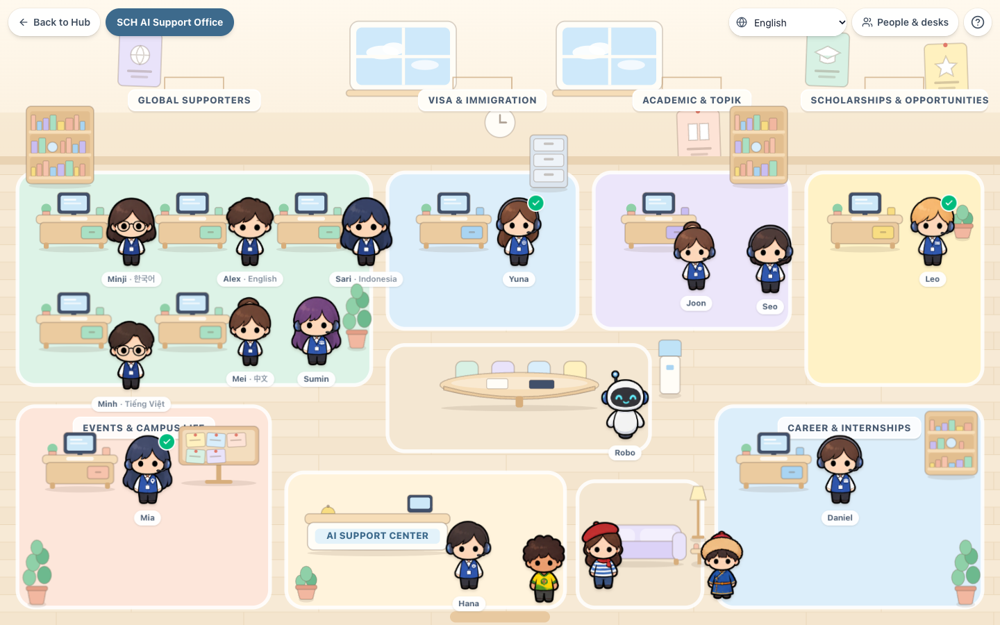
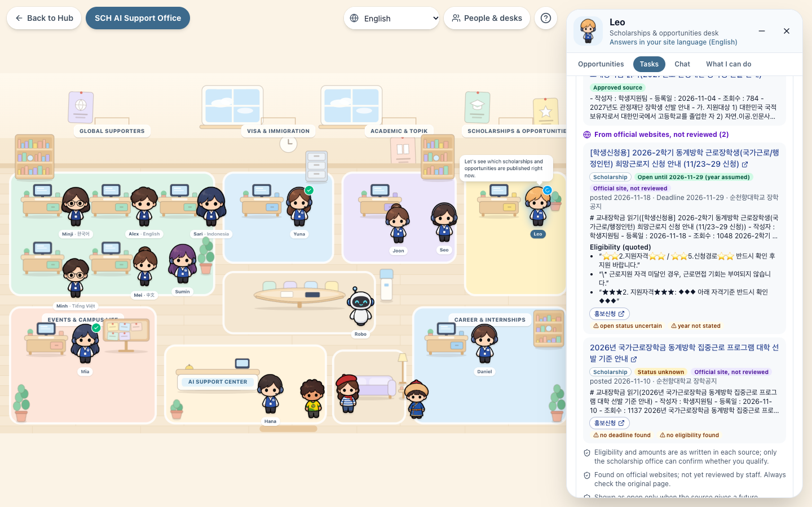
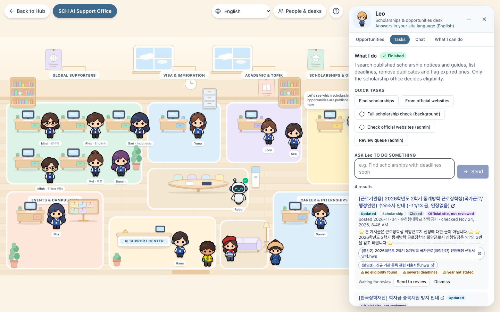
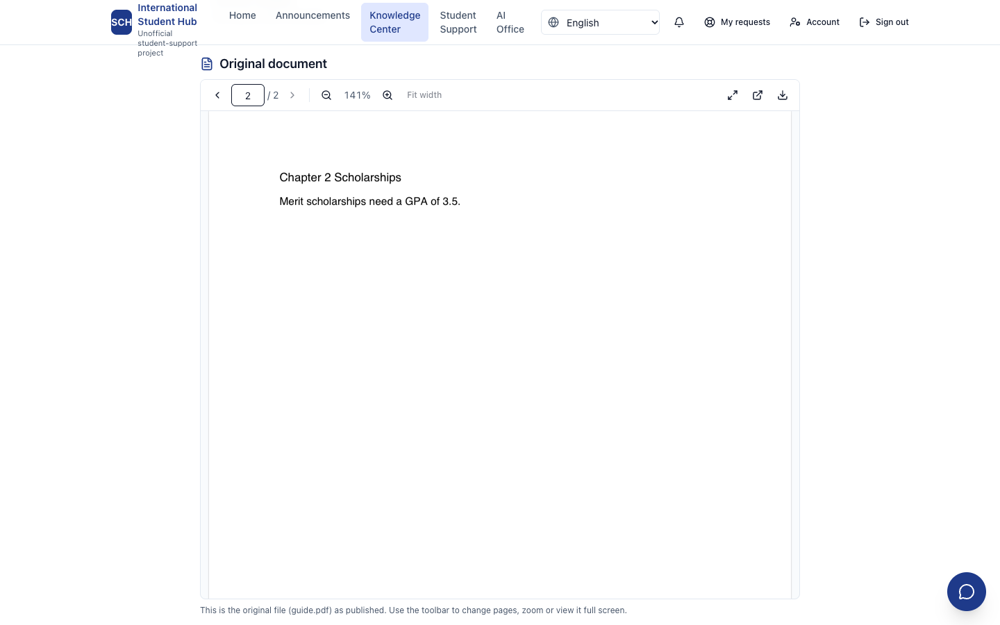
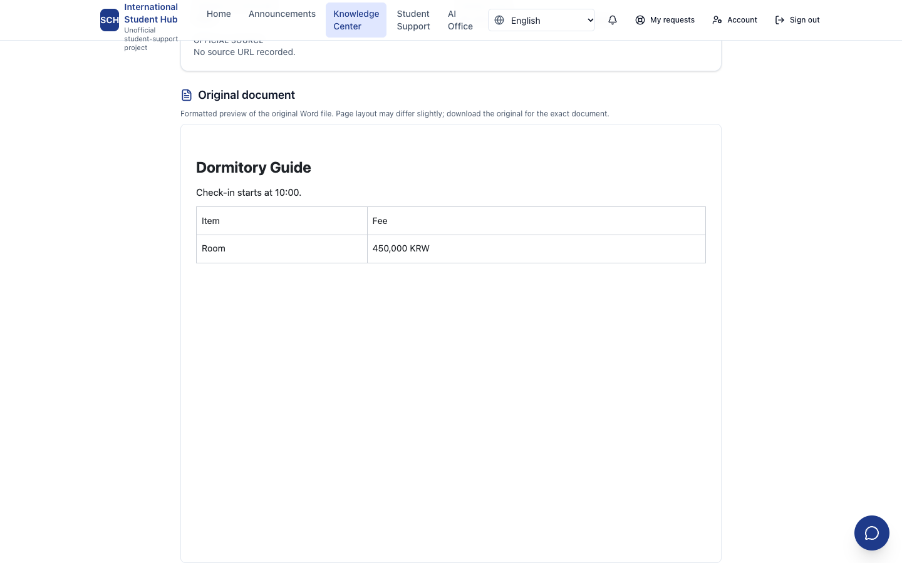
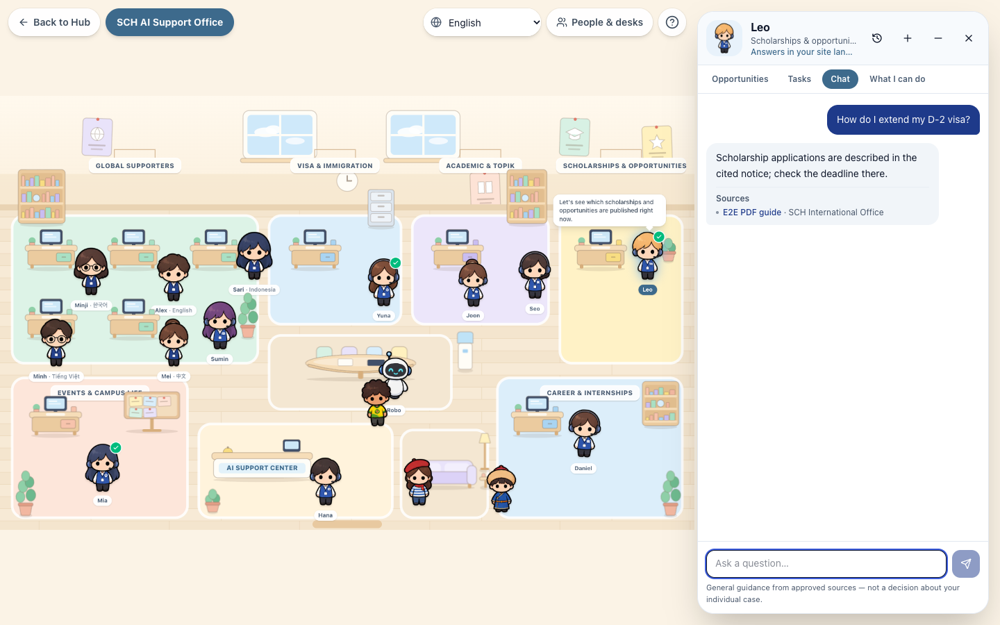
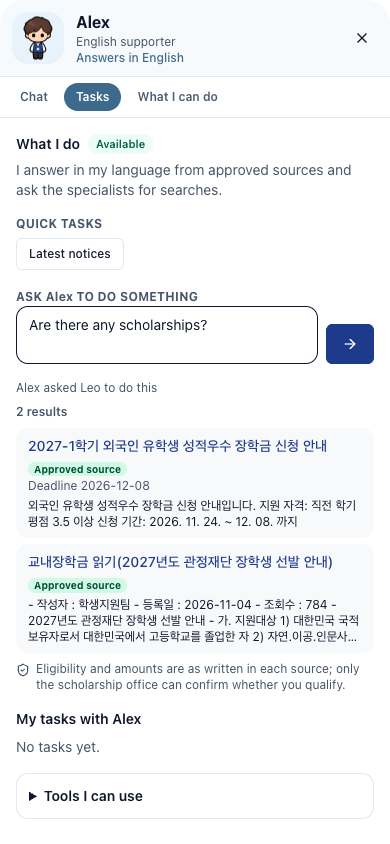
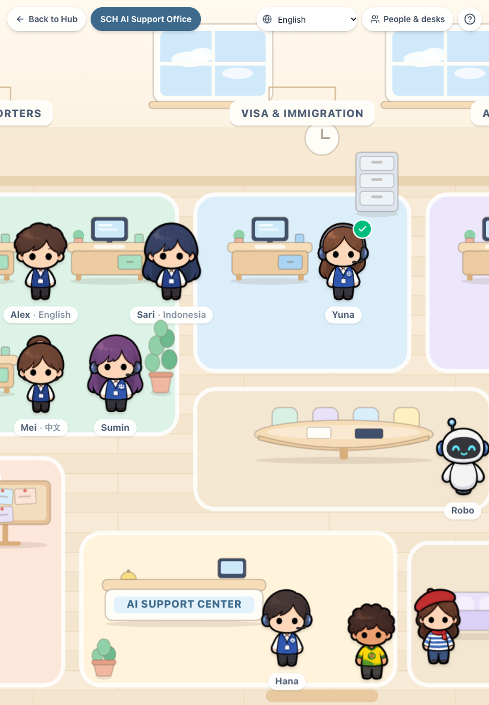

# Release candidate: AI Support Office (Phases 1–3) with the document viewer and translation

Branch `release/ai-office-rc`, based on `main` 671824c, which is what production runs. Nothing has been pushed, deployed or configured in production.

| Commit | Content |
|---|---|
| 44224d8 | Original document viewer, citation navigation, Korean–English machine translation, extractor fixes |
| 9800ae3 | AI Support Office Phase 1 (illustrated office, shared chat, desk data) |
| eb9e806, c9d90fa | Integration merges (chat-widget conflict resolved) |
| c64c2ef | Integration release notes and screenshots |
| c28d4a9 | Phase 2: agents, tool permissions, durable tasks, approval |
| d9de520 | Phase 3: official-source discovery |
| *(this commit)* | Release hardening: source configuration, extraction fixes, monitoring alerts, WebP office art, release tests and docs |

## What is in, and what is out

**In:**
- the original document viewer (PDF.js, DOCX preview) and citation navigation;
- Korean–English translation infrastructure (off by default);
- AI Office Phases 1–3;
- the existing RAG chatbot and the citation-link fixes;
- the Gemini reliability, lifecycle and extractor work already on `main`.

**Out:**
- `research/milestone-5`: experimental rerankers, datasets and evaluation files (none of its files are in the branch);
- the held-back `gemini-failover.patch`;
- local PDFs, model weights and `.env` files.

**Unchanged:** the retrieval settings. `backend/app/core/config.py` differs from `main` only by the new translation, agent and discovery settings.

## 1. Migrations

Production has 0001–0012 applied (read-only check). **Pending, in order:**
1. `20261123000013_automatic_translation`
2. `20261124000014_agent_tasks`
3. `20261124000015_official_source_discovery`

| Check | Result |
|---|---|
| Production schema vs migrations 0001–0012 (read-only catalog fingerprint: columns, constraints, indexes, RLS, policies, function bodies, triggers, 324 grants) | **Identical.** No drift. |
| Upgrade on a production-like scratch copy (0001–0012, reference seed, synthetic data shaped like production: 2 profiles, 22 sources, 26 documents, 767 chunks, 6 announcements, 96 translation rows, 45 jobs, 4 conversations, 140 audit rows) | Each migration runs in a single transaction in 42 / 50 / 47 ms. **Data checksums of all 11 existing tables are unchanged.** |
| What changes in existing objects | Three CHECK constraints are widened (old values still valid). New nullable or defaulted columns. One partial unique index (production has 0 open translation jobs). No existing policy, function or trigger is changed. |
| Old code on the new schema | `main`'s own integration tests pass against the upgraded database, so **migrate first, then deploy** is safe. |
| Idempotency | Re-running all three changes no schema and no data. The schedules are not duplicated. |
| RLS and ownership | RLS is on for all new tables. Students read only their own tasks and steps. Discovery tables are service-role only. Verified with SQL tests and with real JWTs through PostgREST. |
| Rollback | `rollback/…015_down`, then `…014_down`, then `…013_down` returns exactly the 0012 schema with identical data. Re-upgrading afterwards gives the same schema. |
| SQL behaviour suites (11) | All pass on a fresh database. |

**Rollback requirement:** take a backup first. Rolling back 0014 and 0015 loses agent tasks and discovery candidates. Rolling back 0013 removes the translation provenance columns; the rows remain.

## 2. Official SCH sources: proposal for admin approval

Every URL below is linked from the institution's own site. Each was validated live on 2026-11-24 with the real connectors, reading 5 items at 1.5 s pacing. The ready-to-use request bodies are in `sch-sources-proposal.json`.

**Access rules:**
- `home.sch.ac.kr` robots.txt allows all;
- `sgee.sch.ac.kr` and `studyinkorea.go.kr` allow the paths used;
- **`www.sch.ac.kr` disallows bots** and is not used.

**Settings for the university boards** (`listing`):

| Setting | Value |
|---|---|
| Rows | `table tbody tr` |
| Title | `td.subject a` |
| Date | `td.date` |
| Pinned rows skipped | `span.notice` (e.g. a pinned 2024 notice) |
| Article body only | `div.board_contents` (no site menu, author or view-count lines) |
| Attachments | `div.board_file` (finds 신청서 forms) |

The paging parameter `pager.offset` is ignored when identifying items.

**Announcement agent (Robo)**

| Source | Kind | Validation |
|---|---|---|
| SCH 국제교육교류처 유학생 공지사항 `sgee.sch.ac.kr/notice/notice01.php?table_name=noti_fore&loc_mnu=3` | `sch_board` | ok; 5/5 dated; 2 with deadlines; newest 2026-11-23 |
| 순천향대학교 공지사항 `home.sch.ac.kr/sch/06/010100.jsp` | `listing` | ok; 5/5 dated; 5 with deadlines |
| 순천향대학교 학사공지 `home.sch.ac.kr/sch/06/010200.jsp` | `listing` | ok; 5/5 dated; 4 with deadlines |
| 순천향대학교 학사일정 `home.sch.ac.kr/sch/05/010000.jsp` | `page` (change watch) | ok |

**Scholarship and opportunity agent (Leo)**

| Source | Kind | Validation |
|---|---|---|
| 순천향대학교 장학공지 `home.sch.ac.kr/sch/06/010300.jsp` | `listing` | ok; 5/5 dated; real 신청서 attachments found |
| 순천향대학교 취업정보 `home.sch.ac.kr/sch/06/020000.jsp` | `listing` | ok; 5/5 dated; jobs (for Daniel) |
| SCH 국제교육교류처 취업·아르바이트 `sgee…?table_name=over_sea&loc_mnu=5` | `sch_board` | ok; 5/5 dated |
| Study in Korea 장학금 공지 `studyinkorea.go.kr/ko/notice/scholarshipsList.do?boardSort=3` | `listing` | ok; title and date only (items open through a script): status stays "unknown" |
| Study in Korea GKS 장학금 `studyinkorea.go.kr/ko/plan/scholarship.do` | `page` | ok; **closed**, because the page says "접수 기간이 아닙니다" |

**Requested sources with no dedicated official board:**
- *Student activities* and *university events*: no events board is linked from `home.sch.ac.kr`. Events, special lectures and activities are published on 공지사항 and the international board, and are classified there.
- *Academic*: 학사공지 plus the 학사일정 calendar page.

I did not invent any URL.

**Fixes found by validating against the live boards** (each has a regression test from the real phrasing):

| Problem | Example | Fix |
|---|---|---|
| A stated deadline was read as "closed" | "접수 마감: 11/27" | Only explicit statements such as "마감되었습니다" count as closed |
| A department name decided the kind | "[대학일자리플러스센터] 특강" became a job | Bracketed office names are ignored |
| Short range ends were lost, so open notices looked closed | "11. 23. ~ 11. 29.", "(11/23~29)" | Range ends inherit year and month from the start |
| The site menu's link was taken as an application link | "홍보신청" | `content_selector` limits links to the article |

## 3. Authentication and permissions

**Test setup.** The tests ran on the production-like stack: real Postgres and PostgREST with migrations 0001–0015, and the API from this branch on the real store. Tokens were HS256, signed with that stack's own secret and verified by the API exactly as in production. RLS was also checked directly through PostgREST with each user's JWT. No production credentials were used.

**What was not tested.** There is no staging Supabase project, so the hosted Supabase login (GoTrue, JWKS) was not exercised end to end. Its verification code has its own unit tests, and the role and ownership logic after verification is identical.

`tests/integration/test_rbac_integration.py`: **9/9 pass.**

| Check | Result |
|---|---|
| Expired or wrong-secret tokens | 401 |
| A student token claiming an admin role | Still a student; the role comes from the database |
| Unknown profile | 403 `no_profile` |
| Discovery sources, items and schedules; admin checks; review queue | Student 403, Global Supporter 403, admin 200, super-admin 200 |
| Task histories | Private: another student, a supporter, an admin and a super-admin all get 404 and don't see the task in lists. Through PostgREST the owner sees their task and others get `[]`; anon is refused; direct inserts are refused. |
| Discovery and schedule tables | Unreadable for students, even through PostgREST |
| Support request | Prepared by Sumin, delegated from Alex. **No ticket until the student confirms.** Nobody else can confirm. After confirmation it appears in the English supporter's inbox; another student cannot open it. |
| Agent tool permissions | Another desk's tool: 403 for every role. Background tools: never in a request. Admins cannot pass URLs to discovery (422). |

## 4. End-to-end workflow A–H

Real Chrome against the production-like stack: worker job mode as in production, e5 embeddings, live official sources, a scripted model. **21/21 pass in one clean run.**

| Step | Result and provenance |
|---|---|
| A, B | The student asks Alex (English supporter) for scholarships. The response records `delegated_from=supporter-en`, `handled_by=scholarship`, `tool=scholarship_search`. The UI shows "Alex asked Leo to do this". |
| C | Leo returns the Hub-approved scholarship labelled "Approved source", linking to `/announcements/{id}`. |
| Unauthorized crawling | A student starting `opportunity_discovery` gets 403. Student tasks never call `official_source_check`. |
| D | An admin runs "Check official websites". Live progress comes from the task row; the step log is queued › start › tool `official_source_check` › result. |
| E | The candidates are in the review queue, each with its source, URL and last-checked time. |
| F | One is sent to review and becomes a `pending_review` version through the normal ingestion job. Another is dismissed. Audited as `discovered_item.send_to_review` and `discovered_item.dismiss`. |
| G | Before approval: 404 publicly. The admin approves in the existing review flow (`version.approve`, `version.activate`). After that it is public, with `source_url` = the official `home.sch.ac.kr` article. The dismissed item never shows; unreviewed items stay labelled unverified. |
| H | The announcement opens in the announcement page. The approved notice opens in the Knowledge Center. The **PDF renders page 2 at the cited page** (ink checked on the canvas). The **DOCX preview** shows its table. |

The provenance chain for the approved item:
- official URL (`home.sch.ac.kr/sch/06/010300.jsp?mode=view&article_no=…`);
- discovered item (source "순천향대학교 장학공지", first seen 2026-11-24);
- knowledge source (created by an admin);
- version (approved by an admin);
- audit log entries.

## 5. Translation and document viewer

12/12 pass on the same stack.

| Check | Result |
|---|---|
| Automatic translation | No jobs after publishing and approving content: automatic translation is off |
| Who can request drafts | Students get 403. Staff requests create one durable job. |
| Unreviewed drafts | The public sees only the original; public machine translations are off |
| Who can approve | A plain admin gets 403 (language teams review) |
| Approval | Requires "checked against the original". After an English-team reviewer approves, the translation is public and labelled verified. |
| Originals | The PDF bytes are unchanged |
| Chat citations | Open `/knowledge/{id}?page=N`. The approved official notice links to its official URL, announcements to `/announcements/{id}`. |
| Budgets | Daily job limit, quota deferral and per-job request cap are covered by `test_auto_translation.py` (in the backend suite) |

Defaults stay as they are:
- `AUTO_TRANSLATE_ANNOUNCEMENTS` / `AUTO_TRANSLATE_DOCUMENTS`: false;
- `PUBLIC_MACHINE_TRANSLATIONS`: false;
- the backfill is a dry run unless `--apply`.

## 6. Performance

Measured locally on Apple silicon. Production runs on a Render free instance, which is slower.

**API.** Worker mode, e5 ONNX; the model is scripted, so Gemini time is not included.

| Measure | p50 | p95 |
|---|---|---|
| Anonymous chat (retrieval + answer pipeline) | 41 ms | 43 ms |
| Agents directory | 10 ms | 11 ms |
| `scholarship_search` / `opportunity_search` | 30 / 8 ms | 32 / 9 ms |
| Supporter → Leo delegated request | 30 ms | 31 ms |
| Announcements list | 15 ms | 17 ms |

| Measure | Result |
|---|---|
| Background tasks (queue wait / run) | event digest 10/44 ms; scholarship scan 42/90 ms; visa checklist 122/35 ms |
| Translation job (scripted model) | ~50 ms. Real cost is the Gemini latency. |
| Official-source discovery | 11.2 s for one board of 5 items. The time is the deliberate 1.5 s pacing. |
| API process memory | 77 MB at start, 137 MB after chat, tasks and discovery (e5 ONNX loaded). An earlier measurement put e5 at ~440 MB, so check it on Render after deploy. |
| Quotas | Anonymous chat: 6/min per client, then 429 (observed). Instant tools 30/min; tasks 5 active / 30 per day per student; AI daily budgets unchanged. |

**Web.** Production build, Chrome.

| Page | Desktop LCP | JS | Images |
|---|---|---|---|
| `/` | 232 ms | 265 KB | – |
| `/ai-office` | 292 ms | 283 KB | 309 KB |
| `/knowledge/{pdf}` | 292 ms | 396 KB | – |
| `/announcements/{id}` | 272 ms | 265 KB | – |

On a throttled mid-range phone (4× CPU, 1.6 Mbps, 150 ms), **`/ai-office` LCP went from 9.8 s to 3.9 s**. The character art is now served as WebP copies of the same images: same pixel size, alpha kept, 1,442 → 309 KB. The original PNGs are unchanged and remain the fallback.

**Worker contention.** Agent tasks, discovery, ingestion and translation share one worker thread in the API process; chat requests run on request threads and are not blocked. An upload job queued behind a discovery task waited **7.4 s** (the task ran 8.5 s). With the proposed limits a discovery run takes about 1–2 minutes. Mitigations:
- run checks at night;
- keep `max_sources` ≤ 5;
- a separate worker service would remove the contention, but it is a paid Render option and was not enabled.

## 7. Scheduling readiness

| Check | Status |
|---|---|
| Disabled by default | 6 schedules, all off. They run only with `AGENT_SCHEDULES_ENABLED=true` **and** a per-schedule enable. |
| Who can enable | Admin and super-admin only (403 for students and supporters), audited. `review` cannot be set to anything but `admin`. |
| Source-specific limits | Per-source `delay_seconds` (1–10 s, never faster than the global 1.5 s); `max_items` ≤ 30; 10-minute manual re-check throttle. |
| Backoff | A failing source waits 1 h, 2 h, 4 h … up to 24 h between scheduled attempts, and pauses after 5 failures until an admin resets it. A robots or 401/403/429 refusal marks it blocked and stops it. |
| Restart recovery | Tasks of a dead worker are re-queued by `claim_agent_task`, up to 3 attempts (tested). |
| Duplicate prevention | A scheduled run that is still queued or running is reused, not duplicated (tested). Items are unique by canonical URL; the same notice elsewhere is linked as a duplicate. |
| Monitoring and alerts | Admin notifications for: new candidates (scheduled runs); a source failing 3 times; a source blocked or paused; a scheduled task that failed. The source keeps `last_status`, `last_error` and failure count; the schedule keeps `last_error`. |

**Conservative schedule proposal (not activated):**

| Schedule | Interval | Sources | Limits | Approx. requests per run |
|---|---|---|---|---|
| `announcement_discovery` | 720 min (12 h), off-hours | international board, 공지사항, 학사공지, 학사일정 | `max_items_per_source` 10, `max_sources` 4 | ≤ 44 |
| `opportunity_discovery` | 1440 min (24 h), night | 장학공지, 취업정보, 취업·아르바이트, Study in Korea list, GKS page | `max_items_per_source` 10, `max_sources` 5 | ≤ 45 |

For both: `notify_admins: true`, `summarize_new: false`, `review: admin`. The schedules fire only when the existing `run-due` hook is called, so its cron frequency sets the earliest run.

## 8. Security findings

| # | Finding | Status |
|---|---|---|
| 1 | A schema-only `supabase db dump --remote` was attempted for the drift check. It failed for lack of Docker, after the CLI printed "Initialising login role". The Supabase CLI creates a temporary login role for remote dumps. No schema or data was dumped or changed; the drift check was then done with read-only queries. | Reported. You may want to look for a leftover `cli_login_*` role in the dashboard. |
| 2 | Single worker thread: long discovery runs delay ingestion and translation jobs (measured above). | Mitigated by limits and night scheduling; documented. |
| 3 | robots.txt was cached for the life of the process, so a site that newly disallows bots would be ignored until a restart. | Fixed: re-read after 6 h. |
| 4 | The site navigation's "홍보신청" link was taken as an application link. | Fixed with `content_selector`. |
| 5 | Rate limits and throttles are per process (in memory), as before. | Unchanged; fine on one instance. |
| 6 | `anon` / `authenticated` have table grants on several existing tables, guarded by RLS. | Existing design, unchanged. Verified identical to production. |
| 7 | Discovered content is untrusted. | Stored as plain text (≤ 6000 characters), rendered escaped, links http(s) only with `noopener`. Never used by RAG until approved. |

No secrets, `.env` files or local paths are in the branch (scanned before commit).

## 9. Deployment checklist (each step needs your approval)

1. **Back up production.** Use the Supabase dashboard backup or a `pg_dump` of the linked project.
2. **Apply migrations 0013 → 0015 before deploying code.**
   1. `supabase db push --remote --dry-run`: it must list only 0013, 0014 and 0015.
   2. `supabase db push --remote --yes`.
   3. Verify with read-only queries: 6 schedules, all `enabled = false`; RLS on the new tables.
3. **Deploy.** Fast-forward `main` to `release/ai-office-rc` (`main` has not moved) and push. The GitHub workflow calls both Render deploy hooks. No new environment variables are required. Keep these unset or false: `AGENT_SCHEDULES_ENABLED`, `AUTO_TRANSLATE_*`, `PUBLIC_MACHINE_TRANSLATIONS`. No paid Render plan is needed.
4. **Smoke tests:**
   - `GET /health` (embedding model);
   - `GET /api/v1/agents` (15 agents);
   - a student instant lookup;
   - `/ai-office` loads with WebP art;
   - a PDF document page renders;
   - an admin opens the review queue (empty);
   - check API memory on Render.
5. **Configure official sources (optional, separate approval).** Post the entries of `sch-sources-proposal.json` as an admin. Then run one manual check per agent and review the candidates.
6. **Enable schedules (separate approval).** Set `AGENT_SCHEDULES_ENABLED=true` on the Render API service, enable the two schedules with the parameters above, and confirm the `run-due` cron.

## 10. Rollback plan

| Situation | Action |
|---|---|
| Code | Redeploy `671824c` with the Render deploy hook, or revert `main` to it and push. It runs on the migrated schema (tested). |
| Background agent work only | `AGENT_TASKS_ENABLED=false` |
| Schedules | Disable them, or unset `AGENT_SCHEDULES_ENABLED` |
| Database (only if needed, after a backup) | `supabase/rollback/20261124000015_…_down.sql`, then `…014…`, then `…013…`. Tested: it returns exactly the current production schema with existing data intact. |
| A misbehaving source | Disable it through `PATCH /api/v1/admin/discovery/sources/{id}`. Candidates already found stay reviewable or can be dismissed. |

## 11. Remaining limitations

- **No hosted-Supabase login test.** There is no staging project; see section 3.
- **Study in Korea items** open through a script: title and date only, status "unknown".
- **No dedicated events board** on `home.sch.ac.kr`; events come from the notice boards.
- **Keyword classification.** Category and kind can be wrong on unusual titles; the matched word is shown to reviewers.
- **Pattern-based dates.** Years in titles such as "(~11/13)" are assumed (flagged). Notices removed from a board are not detected.
- **Shared worker thread** (section 6). The memory footprint must be confirmed on Render.
- **Performance figures are local.** Render free-tier latency, cold starts (sleep) and real Gemini latency will be higher.
- **The translation stand-in model** produced placeholder text in the local screenshots; real translations depend on the configured Gemini model.

## Screenshots (production build, production-like stack)

| | |
|---|---|
|  |  |
|  |  |
|  |  |
|  |  |
