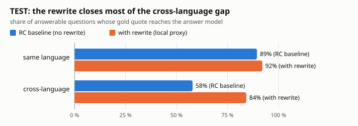

# Multilingual retrieval and answers

Release 1 scope is unchanged: announcement **translation** stays ko / en / id. The chatbot itself takes questions in all
five site languages (ko, en, id, vi, zh-CN), so every dataset asks each need in all five.

## 1. The problem is cross-language, not "Korean"

DEV + VALIDATION, baseline on PostgreSQL (question language → language of the primary document):

| Pair | n | hit@1 | MRR | primary reaches the model |
|---|---|---|---|---|
| same language (en→en, ko→ko) | 40 | 0.78 | 0.871 | 1.00 |
| ko → en | 30 | **0.30** | **0.439** | **0.53** |
| vi → en | 30 | 0.37 | 0.570 | 0.80 |
| en → ko | 10 | 0.40 | 0.510 | 0.60 |
| zh → en / id → en | 30 / 30 | 0.63 / 0.67 | 0.731 / 0.790 | 0.87 / 0.97 |

TEST (frozen; 23 of its 42 needs are answered by Korean documents), gold quote reaches the answer model:

| Question language | n | baseline (RC, no rewrite) | with rewrite (local proxy) |
|---|---|---|---|
| en | 38 | **0.526** (primary doc 0.605) | 0.842 (0.895) |
| ko | 38 | 0.658 | 0.921 |
| id | 38 | 0.605 | 0.789 |
| vi | 38 | 0.605 | 0.868 |
| zh-CN | 38 | 0.816 | 0.868 |
| same language as the evidence | 38 | 0.895 | 0.921 |
| **cross-language** | 152 | **0.579** | **0.842** |

On TEST, *English* questions are the weakest without a rewrite because most needs are Korean notices. The common factor
is the language gap between question and evidence. multilingual-e5-small places a question close to text in its own
language: the "same-language pull" of ERROR-ANALYSIS.md, the most harmful failure (15 of the 30 DEV / VAL questions whose
primary document never reached the model).

## 2. What closes the gap

| Measure (VALIDATION, primary doc reaches the model) | value |
|---|---|
| baseline, no rewrite | 0.80 |
| + glossary bridge (production default; without it) | 0.80 (0.81 without; neutral on VAL, +0.03 on DEV) |
| + English variant of the same need (oracle) | 0.95 |
| + English and Korean variants (oracle) | 0.94 |
| + rewrite by a local model (the production prompt, Qwen 2.5 7B) | 0.88 |
| TEST: baseline → rewrite proxy | 0.842 → **0.974** (+0.132 [+0.079, +0.184]) |

**Query variants in the evidence's language are the measure that works.** Production already asks Gemini Flash-Lite
for English and Korean variants on every turn with an LLM. The risk is the **path without a rewrite**: no LLM
configured, the provider down, or the daily budget used up (`_queries` then falls back to the original question).
On that path, cross-language questions reach their evidence only 58 % of the time on TEST.

## 3. Rewrite proxy quality (445 rewrites, DEV + VAL + TEST + negatives, `rewrites_qwen2.5-7b.json`)

| Observation | count |
|---|---|
| median rewrite latency (RTX 4070, 7B, temperature 0) | 0.8 s |
| "standalone" question not in the student's script (mostly Vietnamese written as Chinese) | 32 (vi 17 / 89) |
| Korean variant containing Chinese characters | 27 |
| fewer than three distinct queries | 58 |
| variants dropped because they changed a visa code (existing guard) | 2 |

The proxy is clearly imperfect and still gives the largest measured gain. Gemini Flash-Lite is expected to write
cleaner variants, but **this is not measured** (no key here; BLOCKERS B1). The owner's capped run (ANSWER-EVALUATION
§6) records the rewrites, so the same analysis can be repeated on Gemini output.

## 4. Answer language

With retrieval, the local proxy answered in the wrong language in **0 / 200** DEV + VAL questions (the engine's
language check retries once and otherwise falls back). Closed-book, the same model answered in the wrong language in
15 % of questions. TEST: ANSWER-EVALUATION.md.

## 5. Recommendations

1. Keep the rewrite on (production). Watch how often it fails: `metadata.rewritten` per assistant message
   (PRODUCTION-READINESS §4). Every failed rewrite drops a cross-language question to the weak path.
2. For the no-LLM path, a deterministic variant (glossary terms in the other language, already the "bridge") is the
   only free option; it helps DEV only. A small local translator was not tested for production because production must
   not depend on the university GPU.
3. Native speakers should check the five-language questions (HUMAN-REVIEW-CHECKLIST R1 / R2) before these numbers are
   called human-validated.
