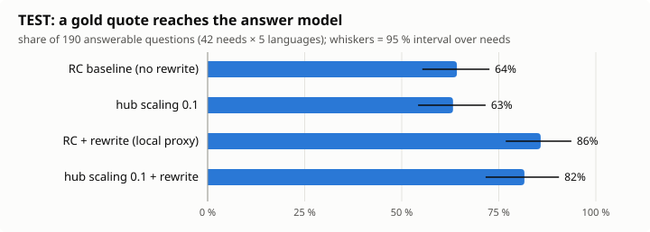
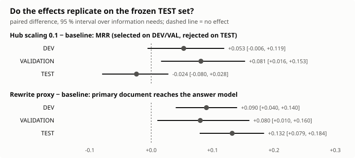

# Retrieval results

Protocol and definitions: RETRIEVAL-EXPERIMENTS.md. Labels are AI-drafted and unreviewed. Memory store unless noted;
TEST headline numbers confirmed on real PostgreSQL + pgvector (T3).

## 1. Main table

Document-level columns (hit@1, MRR, nDCG) come from a single-query search, so they do not change with the rewrite.
`ctx_*` and fused MRR come from the assistant stage. TEST intervals: 95 %, over needs.

| Split | Configuration | hit@1 | MRR | nDCG@10 | primary doc in context | gold quote in context | fused MRR |
|---|---|---|---|---|---|---|---|
| DEV | `baseline` | 0.690 | 0.782 | 0.820 | 0.900 | — | 0.772 |
| DEV | `hub0.1` | 0.760 | 0.836 | 0.825 | 0.920 | — | 0.827 |
| DEV | `llm_rewrite` | 0.690 | 0.782 | 0.820 | 0.990 | — | 0.837 |
| DEV | `hub0.1_llm_rewrite` | 0.760 | 0.836 | 0.825 | 0.980 | — | 0.877 |
| VAL | `baseline` | 0.520 | 0.656 | 0.753 | 0.800 | — | 0.640 |
| VAL | `hub0.1` | 0.630 | 0.737 | 0.782 | 0.850 | — | 0.725 |
| VAL | `llm_rewrite` | 0.520 | 0.656 | 0.753 | 0.880 | — | 0.747 |
| VAL | `hub0.1_llm_rewrite` | 0.630 | 0.737 | 0.782 | 0.940 | — | 0.808 |
| **TEST** | `baseline` (RC) | 0.647 [0.56, 0.73] | 0.742 [0.68, 0.80] | 0.765 [0.72, 0.81] | 0.842 [0.79, 0.89] | 0.642 [0.55, 0.73] | 0.728 [0.66, 0.79] |
| **TEST** | `hub0.1` | 0.605 [0.52, 0.69] | 0.718 [0.65, 0.78] | 0.734 [0.68, 0.78] | 0.837 [0.78, 0.88] | 0.632 [0.54, 0.72] | 0.703 [0.63, 0.77] |
| **TEST** | `llm_rewrite` | 0.647 | 0.742 | 0.765 | **0.974 [0.95, 0.99]** | **0.858 [0.77, 0.94]** | 0.731 [0.67, 0.79] |
| **TEST** | `hub0.1_llm_rewrite` | 0.605 | 0.718 | 0.734 | 0.942 [0.89, 0.98] | 0.816 [0.72, 0.91] | 0.721 [0.65, 0.79] |
| TEST, PostgreSQL | `baseline` | 0.647 | 0.742 | 0.764 | 0.842 | 0.653 | 0.728 |
| TEST, PostgreSQL | `hub0.1` | 0.600 | 0.715 | 0.734 | 0.837 | 0.642 | 0.700 |

Other PostgreSQL configurations (DEV / VAL MRR): vector only 0.620 / 0.575; keyword only 0.184 / 0.197; legacy SQL fusion
0.517 / 0.465; no bridge 0.752 / 0.666 (E2).

## 2. Paired effects (need-level 95 % intervals)

| Effect | DEV | VALIDATION | TEST | Verdict |
|---|---|---|---|---|
| query variants (local rewrite proxy) − baseline, primary doc in context | +0.090 [+0.04, +0.14] | +0.080 [+0.01, +0.16] | **+0.132 [+0.079, +0.184]** | confirmed |
| same, gold quote in context | — | — | **+0.216 [+0.147, +0.284]** (needs +27 / −2) | confirmed |
| oracle translation (en + ko) − baseline, primary doc in context | +0.09 [+0.04, +0.15] | +0.14 [+0.06, +0.23] | not run on TEST | upper bound |
| hub scaling β 0.1 − baseline, MRR | +0.053 [−0.006, +0.119] | +0.081 [+0.016, +0.153] | **−0.024 [−0.080, +0.028]** | **not confirmed** (P2 rule fails) |
| hub scaling + rewrite − rewrite, gold quote in context | — | — | −0.042 [−0.095, −0.011] | hub scaling hurts here too |
| chunker v2 − v1 (baseline ranking), MRR | −0.041 [−0.076, −0.009] | −0.067 [−0.121, −0.023] | −0.049 [−0.080, −0.019] (post-hoc) | costs single-query ranking |
| chunker v2 − v1 with rewrite, gold quote in context | — | — | +0.016 [−0.021, +0.053] (post-hoc) | neutral |

## 3. Why hub scaling failed on TEST

Hub scaling (long documents scaled down) won on DEV and VALIDATION and was selected by rule P1, then lost on TEST:

| TEST subset | questions | MRR baseline | MRR hub0.1 | change |
|---|---|---|---|---|
| needs where **no** hub guide is a grade-2 source | 140 | 0.721 | 0.729 | +0.008 |
| needs where a hub guide **is** a grade-2 source | 50 | 0.800 | 0.688 | **−0.112** |

DEV and VALIDATION label the specific document as primary and rarely credit a guidebook that also answers (their labels
are not exhaustive). Penalising guides therefore looked free on DEV / VAL. TEST was graded exhaustively and contains
10 needs that a guide answers (two only by a guide). The DEV / VAL gain did not hold there. The previous mission saw the
same pattern on its own blind set (RC `docs/development/KOREAN-RETRIEVAL.md`): the same penalty (0.1) raised MRR from
0.602 to 0.723 when only the specific document counted, and lowered it from 0.845 to 0.819 when the guides counted as
acceptable answers. Whether hub scaling "works" depends on whether a guide that answers counts as correct. For students
it does. **Hub scaling stays off.**

## 4. Chunker v2 (text loss fix)

| | v1 (release) | v2 |
|---|---|---|
| corpus text in no chunk | 13.3 % (Korean guidebook 57.7 %) | 0.1 % (long table rows split between chunks, text present) |
| chunks | 749 | 782 |
| TEST gold quotes inside one chunk | 54 / 57 | 57 / 57 |
| TEST gold quote in context, with rewrite | 0.858 | 0.874 (+0.016 [−0.021, +0.053], post-hoc) |
| TEST single-query MRR | 0.742 | 0.693 (−0.049 [−0.080, −0.019]) |

The three needs whose evidence v1 had lost (gold quote reaches the model, with rewrite; post-hoc): VIS-05
(leave of absence: leave Korea within 15 days, answered only by the two guidebooks) 0.0 → 0.4, VIS-10 0.6 → 1.0,
WRK-01 1.0 → 1.0. Without the rewrite: 0.0 → 0.2, 0.4 → 0.8, 0.8 → 1.0.

v2 is a correctness fix, and it is neutral on the production path, where the rewrite adds query variants. Without the
rewrite (provider down, no LLM), the now-complete guidebook ranks first more often. Recommendation in
PRODUCTION-READINESS.md.

## 5. Stores

The in-memory mirror and PostgreSQL agree: the same first-relevant rank for 98 / 100, 98 / 100 and 208 / 210 questions.
The headline TEST numbers are identical (MRR 0.742); the gold quote reaches the model in 0.642 (memory) and 0.653
(PostgreSQL) of questions. HNSW (pgvector default `ef_search` 40) did not change any conclusion on this 749-chunk index.

## 6. Per-topic results (TEST, baseline unless noted; strict = grade-2 document)

| Topic | n | hit@1 | hit@3 | hit@10 | recall@10 | MRR | nDCG@10 | gold quote in context: baseline → rewrite |
|---|---|---|---|---|---|---|---|---|
| academic-procedures | 35 | 0.60 | 0.74 | 0.83 | 0.81 | 0.682 | 0.720 | 0.66 → 0.89 |
| admission | 10 | 0.80 | 0.80 | 0.90 | 0.90 | 0.811 | 0.830 | **0.00 → 0.00** |
| dormitory | 30 | 0.73 | 0.77 | 0.97 | 0.97 | 0.782 | 0.818 | 0.73 → 0.97 |
| employment | 10 | 0.50 | 0.90 | 1.00 | 1.00 | 0.679 | 0.724 | 0.80 → 1.00 |
| health-insurance | 10 | 0.60 | 0.90 | 1.00 | 1.00 | 0.750 | 0.802 | 0.80 → 1.00 |
| part-time-employment | 25 | 0.72 | 0.96 | 0.96 | 0.93 | 0.840 | 0.816 | 0.80 → 0.92 |
| residence-card | 15 | 0.87 | 1.00 | 1.00 | 0.93 | 0.922 | 0.816 | 0.87 → 0.93 |
| scholarship | 5 | 0.40 | 0.40 | 1.00 | 1.00 | 0.523 | 0.694 | 0.80 → 0.80 |
| student-records | 5 | 0.40 | 0.40 | 0.60 | 0.60 | 0.450 | 0.486 | 0.40 → 1.00 |
| topik | 10 | 0.30 | 0.70 | 1.00 | 1.00 | 0.541 | 0.652 | 0.70 → 1.00 |
| visa-immigration | 35 | 0.66 | 0.77 | 1.00 | 0.99 | 0.747 | 0.769 | 0.43 → 0.77 |

Overall TEST baseline (95 % need-level intervals): hit@1 0.647 [0.563, 0.726], hit@3 0.800 [0.737, 0.858], hit@5
0.863 [0.821, 0.905], hit@10 0.942 [0.905, 0.974], recall@5 0.813, recall@10 0.928 [0.888, 0.963], MRR 0.742
[0.680, 0.800] (lenient 0.773), nDCG@5 0.708, nDCG@10 0.765 [0.721, 0.805], P@5 0.297.

**Document found, passage lost.** Admission (ADM-01 nursing ★ footnote, ADM-02 refund after a visa refusal): the
47-chunk admission guide is found (hit@10 0.90), but the one passage with the rule never reaches the model, with or
without the rewrite. Selection keeps at most 3 passages per document, and the footnote and refund rule lose to the
admission tables. This is the next retrieval problem worth working on (passage selection inside long documents).

